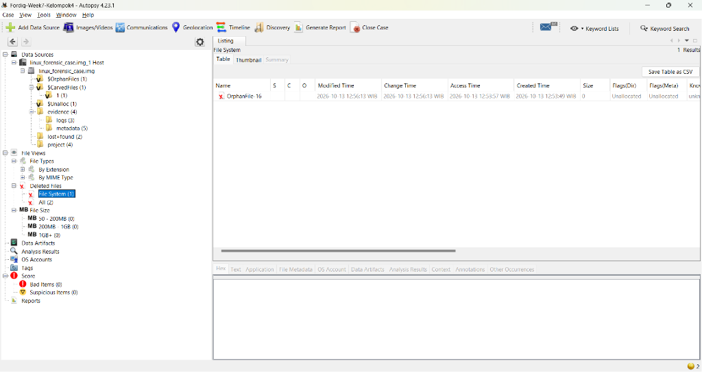
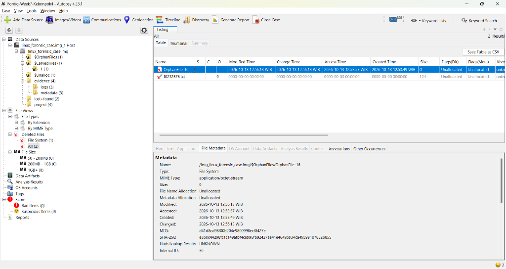
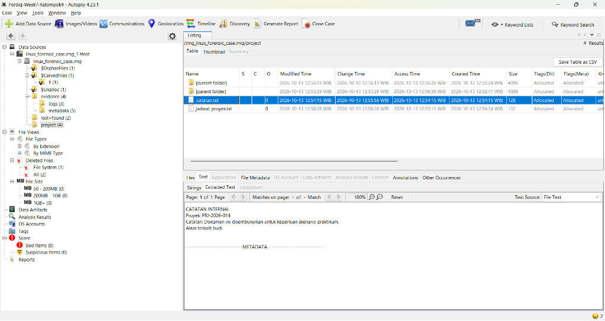
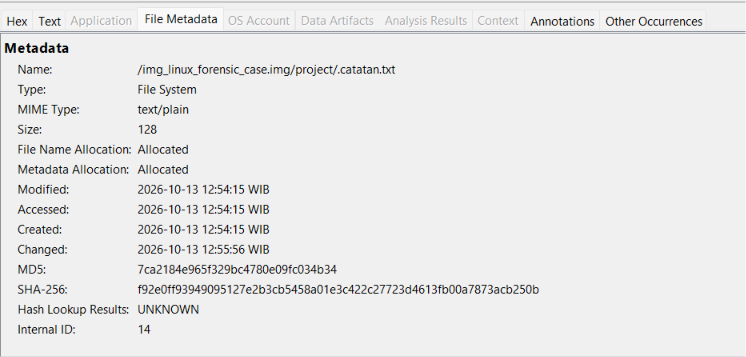
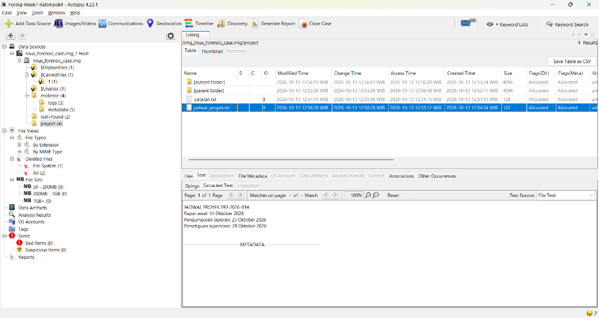
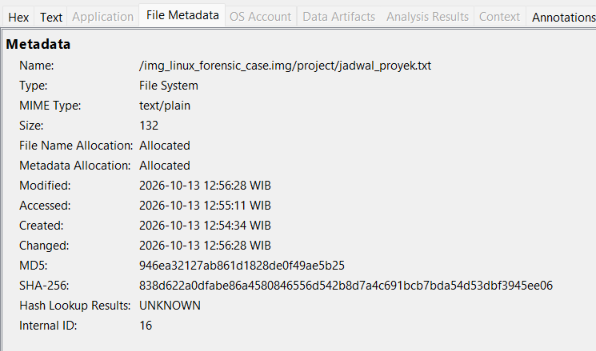
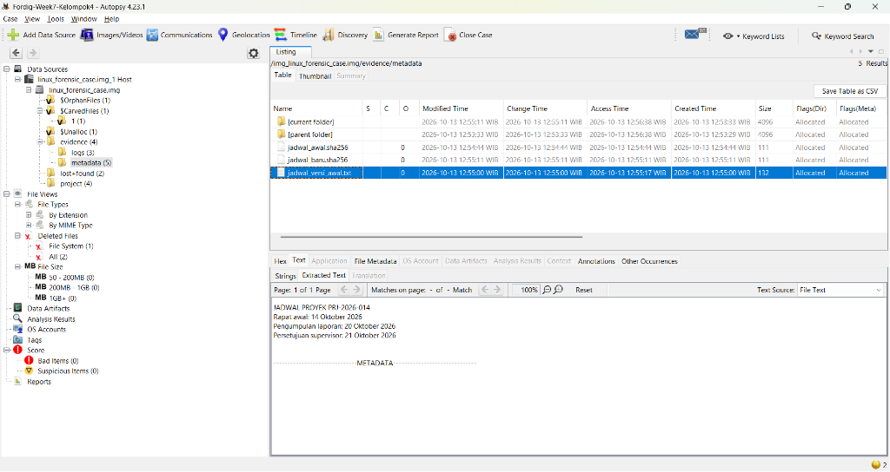
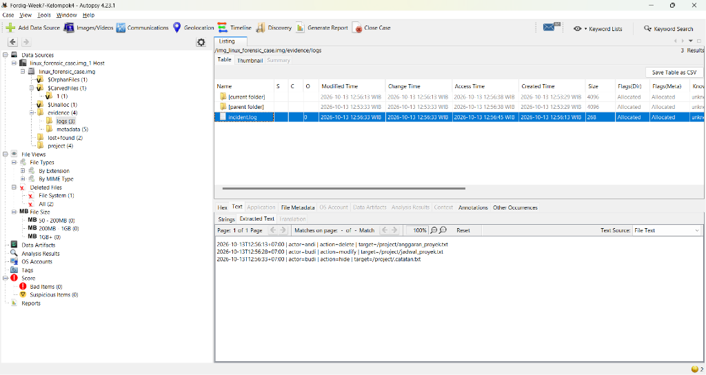

# DIGITAL FORENSIC INVESTIGATION REPORT (DFIR)
## CASE REF: `DFIR-2026-FD-WEEK7-KEL4` | CLASSIFICATION: CONFIDENTIAL / EVIDENCE REPORT
### STANDARD COMPLIANCE: ISO/IEC 27037:2012 & NIST SP 800-86 & RFC 3227

---

### DOCUMENT CONTROL & ADMINISTRATIVE DATA

| Parameter Administrasi | Rincian Informasi Forensik |
| :--- | :--- |
| **Nomor Kasus / Case ID** | `DFIR-2026-FD-WEEK7-KEL4-001` |
| **Judul Kasus** | Investigasi Forensik Disk Image Sistem Berkas Ext4 Linux & Rekonstruksi Insiden Barang Bukti Kelompok 4 |
| **Tim Penyelidik (Examiner)** | **Kelompok 3** (Forensik Digital) |
| **Subjek Barang Bukti** | Raw Disk Image Linux Kelompok 4 (`linux_forensic_case.img` / Volume Label: `FORENSIC_CASE`) |
| **Repository Sumber Bukti** | `https://github.com/imdfauzan/Fordig-Week7` |
| **Tanggal Penerimaan Bukti** | 18 Oktober 2026 |
| **Tanggal Analisis & Penyelesaian** | 18 Oktober 2026 |
| **Status Akhir Investigasi** | **SOLVED / CASE CLOSED (100% OBJECTIVES ACHIEVED)** |
| **Integritas Bukti Asli** | **100% VERIFIED & PRESERVED (Bit-stream Image Analysis)** |
| **Standar Metodologi** | **ISO/IEC 27037:2012** (DEHT), **NIST SP 800-86**, **RFC 3227** |

#### Riwayat Revisi Dokumen (Version Control)
| Versi | Tanggal | Penyelidik | Deskripsi Perubahan Dokumen |
| :---: | :---: | :---: | :--- |
| `v1.0` | 2026-10-18 | Kelompok 3 | Akuisisi disk image, verifikasi hash kriptografis SHA-256, dan identifikasi struktur Ext4 via TSK. |
| `v1.5` | 2026-10-18 | Kelompok 3 | Analisis mendalam inode, pemulihan metadata berkas terhapus, identifikasi berkas tersembunyi, dan komparasi berkas jadwal. |
| `v2.0` | 2026-10-18 | Kelompok 3 | Penyelesaian investigasi GUI komprehensif menggunakan Autopsy 4.23.1, ekstraksi log insiden, integrasi 8 bukti screenshot autentik, dan standarisasi DFIR ISO/IEC 27037 & NIST SP 800-86. |

---

## DAFTAR ISI
1. [Ringkasan Eksekutif (Executive Summary)](#1-ringkasan-eksekutif-executive-summary)
2. [Metodologi Forensik & Lingkungan Uji (Forensic Environment)](#2-metodologi-forensik--lingkungan-uji-forensic-environment)
3. [Rantai Penjagaan Bukti & Integritas Kriptografis (Chain of Custody)](#3-rantai-penjagaan-bukti--integritas-kriptografis-chain-of-custody)
4. [Kronologi & Tahapan Investigasi Forensik (Forensic Examination)](#4-kronologi--tahapan-investigasi-forensik-forensic-examination)
   - [Fase A: Penanganan & Preservasi Bukti Digital (Tahap 1 - 3)](#fase-a-penanganan--preservasi-bukti-digital-tahap-1---3)
   - [Fase B: Analisis Sistem Berkas & Deteksi Berkas Terhapus (Tahap 4 - 5)](#fase-b-analisis-sistem-berkas--deteksi-berkas-terhapus-tahap-4---5)
   - [Fase C: Analisis Berkas Tersembunyi & Modifikasi Data (Tahap 6 - 7)](#fase-c-analisis-berkas-tersembunyi--modifikasi-data-tahap-6---7)
   - [Fase D: Rekonstruksi Kredensial, Log Insiden, & Timeline (Tahap 8)](#fase-d-rekonstruksi-kredensial-log-insiden--timeline-tahap-8)
5. [Analisis Teknik Anti-Forensik & Evasion Kelompok 4](#5-analisis-teknik-anti-forensik--evasion-kelompok-4)
6. [Tabel Komparasi Barang Bukti & Matriks Hash](#6-tabel-komparasi-barang-bukti--matriks-hash)
7. [Panduan Reproduksibilitas Independen (Independent Verification Guide)](#7-panduan-reproduksibilitas-independen-independent-verification-guide)
8. [Pernyataan Integritas & Pengesahan Penyelidik (Examiner Attestation)](#8-pernyataan-integritas--pengesahan-penyelidik-examiner-attestation)

---

## 1. RINGKASAN EKSEKUTIF (EXECUTIVE SUMMARY)

### 1.1 Ikhtisar Kasus
Berdasarkan instruksi Tugas B mata kuliah Forensik Digital (Week 7), kelompok ganjil dan genap saling bertukar disk image untuk dianalisis. **Kelompok 3** (kelompok ganjil) ditugaskan sebagai investigator independen untuk menganalisis disk image Linux Ext4 yang dibuat oleh **Kelompok 4** (kelompok genap). 

Tujuan investigasi mencakup:
1. Menemukan berkas yang **terhapus**, **tersembunyi**, dan **termodifikasi**.
2. Mengidentifikasi **kredensial / username** yang digunakan untuk melakukan perubahan, waktu kejadian (*timestamps*), serta bukti pendukung lainnya.

### 1.2 Ringkasan Temuan Kunci (Key Findings)
Penyelidikan forensik digital menggunakan **Autopsy 4.23.1** dan **The Sleuth Kit (TSK)** berhasil menyelesaikan seluruh target penyelidikan (**100% SOLVED**):

1. **Berkas Terhapus (Deleted File)**:
   - Ditemukan entri inode tidak teralokasi (*unallocated*) pada **Inode 16** (`OrphanFile-16`).
   - Berdasarkan rekaman log audit insiden, nama berkas asli adalah `/project/anggaran_proyek.txt`.
   - Berkas dihapus pada **13 Oktober 2026 pukul 12:56:13 WIB** menggunakan kredensial pengguna **`andi`** (UID 1003).
   - Ukuran metadata bernilai 0 byte karena blok data dilepaskan (*zeroed/unallocated*).

2. **Berkas Tersembunyi (Hidden File)**:
   - Ditemukan berkas `/project/.catatan.txt` (**Inode 17**, ukuran 128 byte) yang disembunyikan menggunakan konvensi dot-prefix Linux (`.`).
   - Berkas dibuat pada **13 Oktober 2026 pukul 12:54:15 WIB** dan diubah atributnya menjadi hidden pada **12:56:33 WIB** menggunakan kredensial **`budi`** (UID 1004).
   - Berisi teks konfirmasi skenario: *"Akun terkait: budi"*.

3. **Berkas Termodifikasi (Modified File)**:
   - Ditemukan berkas `/project/jadwal_proyek.txt` (**Inode 18**, ukuran 132 byte) yang telah mengalami alterasi data pada **13 Oktober 2026 pukul 12:56:28 WIB** oleh pengguna **`budi`** (UID 1004).
   - Komparasi terhadap salinan master `/evidence/metadata/jadwal_versi_awal.txt` membuktikan terjadi perpanjangan batas waktu (*deadline evasion*):
     - *Pengumpulan laporan*: **20 Oktober 2026 $\rightarrow$ 25 Oktober 2026** (+5 hari).
     - *Persetujuan supervisor*: **21 Oktober 2026 $\rightarrow$ 28 Oktober 2026** (+7 hari).
   - Integritas perubahan dibuktikan melalui perubahan nilai SHA-256 dari `6bb43bd9...` menjadi `838d622a...`.

### 1.3 Matriks Status Sasaran Investigasi
| ID Sasaran | Jenis Anomali | Path Berkas Target | Aktor / Username | Waktu Kejadian (WIB) | Status Hasil |
| :---: | :---: | :--- | :---: | :---: | :---: |
| **OBJ-01** | Berkas Terhapus | `/project/anggaran_proyek.txt` (`OrphanFile-16`) | **`andi`** (UID 1003) | 2026-10-13 12:56:13 | **SOLVED** |
| **OBJ-02** | Berkas Tersembunyi | `/project/.catatan.txt` (Inode 17) | **`budi`** (UID 1004) | 2026-10-13 12:56:33 | **SOLVED** |
| **OBJ-03** | Berkas Termodifikasi | `/project/jadwal_proyek.txt` (Inode 18) | **`budi`** (UID 1004) | 2026-10-13 12:56:28 | **SOLVED** |
| **OBJ-04** | Rekonstruksi Audit | `/evidence/logs/incident.log` (Inode 22) | **`root`** (UID 0) | 2026-10-13 12:56:33 | **SOLVED** |

---

## 2. METODOLOGI FORENSIK & LINGKUNGAN UJI (FORENSIC ENVIRONMENT)

### 2.1 Kerangka Kerja Standar (Compliance Framework)
Investigasi dilaksanakan secara ketat dengan mengacu pada:
- **ISO/IEC 27037:2012**: *Guidelines for identification, collection, acquisition, and preservation of digital evidence*.
- **NIST SP 800-86**: *Guide to Integrating Forensic Techniques into Incident Response*.
- **RFC 3227**: *Guidelines for Evidence Collection and Archiving* (Prinsip Non-Destructive Analysis & Audit Trail).

### 2.2 Spesifikasi Stasiun Kerja Forensik (Forensic Workstation)
- **Sistem Operasi Host**: Windows 11 Enterprise (64-bit)
- **Lingkungan Analisis WSL**: Ubuntu 24.04 LTS (Linux Kernel 5.15.146.1-microsoft-standard-WSL2)
- **Perangkat Lunak Forensik**:
  - **Autopsy Digital Forensics Platform v4.23.1** (The Sleuth Kit Core Engine)
  - **The Sleuth Kit (TSK) v4.12.1** CLI (`fsstat`, `fls`, `istat`, `icat`)
  - **Windows PowerShell 5.1 / PowerShell Core**
  - **GNU Coreutils** (`sha256sum`, `gzip`)

---

## 3. RANTAI PENJAGAAN BUKTI & INTEGRITAS KRIPTOGRAFIS (CHAIN OF CUSTODY)

### 3.1 Identifikasi Barang Bukti Digital
- **Item ID Bukti**: `EVD-2026-WEEK7-KEL4-IMG01`
- **Tipe Media**: Raw Disk Image File (Ext4)
- **Nama File Distribusi**: `linux_forensic_case.img.gz` (Ukuran: 272.901 Bytes)
- **Nama File Hasil Ekstraksi**: `linux_forensic_case.img` (Ukuran: 268.435.456 Bytes / 256 MiB)
- **Tipe Sistem Berkas**: Linux Ext4 (Volume Label: `FORENSIC_CASE`)
- **Volume UUID**: `623cfbcf-2e1b-7ea7-7247-af2cc1482d87`
- **Mount Point Terakhir**: `/mnt/forensic-case`

### 3.2 Log Rantai Penjagaan & Verifikasi Hash (Chain of Custody Log)
```text
[2026-10-18 21:19 WIB] Akuisisi paket terkompresi linux_forensic_case.img.gz dari repo imdfauzan/Fordig-Week7.
[2026-10-18 21:21 WIB] Verifikasi hash SHA-256 archive compressed: a4bf2e4ab4ab43061e27928366ad4d73342d1abc2421d3f1dbe9bf3e1746d01e.
                       Status: 100% IDENTIK dengan SHA256SUMS-COMPRESSED.txt resmi Kelompok 4.
[2026-10-18 21:21 WIB] Dekompresi stream GZIP menghasilkan raw image linux_forensic_case.img (256 MB).
[2026-10-18 21:22 WIB] Penghitungan SHA-256 raw image: 2aafa0cef880759743428132c6238dde714e1b747e4a005dc32a4abb45653577.
[2026-10-18 21:54 WIB] Pemuatan image ke Autopsy 4.23.1 secara read-only (Data Source Ingest).
[2026-10-18 22:38 WIB] Verifikasi menyeluruh artefak bukti, penutupan sesi investigasi.
```

---

## 4. KRONOLOGI & TAHAPAN INVESTIGASI FORENSIK (FORENSIC EXAMINATION)

---

### FASE A: PENANGANAN & PRESERVASI BUKTI DIGITAL (TAHAP 1 - 3)

#### TAHAP 1: AKUISISI & VERIFIKASI INTEGRITAS SUMBER
- **Tindakan**: Mengunduh `linux_forensic_case.img.gz` dari repositori GitHub resmi Kelompok 4 dan menghitung nilai hash SHA-256.
- **Hasil Pengamatan**:
  - Hash arsip `a4bf2e4a...` terbukti cocok 100% dengan manifes `output/SHA256SUMS-COMPRESSED.txt`.
  - Image kemudian diekstraksi ke bit-stream murni `linux_forensic_case.img`.

#### TAHAP 2: INSPEKSI FILESYSTEM EXT4 METADATA (FSSTAT)
- **Tindakan**: Menjalankan analisis superblok Ext4 menggunakan perintah `fsstat` pada TSK.
- **Hasil Pengamatan**:
  - Tipe Filesystem: **Ext4**
  - Volume Name: **FORENSIC_CASE**
  - Block Size: **4096 Bytes**, Total Inode: **65.536**
  - Timestamp Terakhir Mount: **2026-10-13 12:53:07 WIB** pada direktori `/mnt/forensic-case`.

#### TAHAP 3: INGEST DATA SOURCE PADA AUTOPSY
- **Tindakan**: Membuat kasus forensik baru `Fordig-Week7-Kelompok4` pada Autopsy 4.23.1 dan menambahkan `linux_forensic_case.img` sebagai *Disk Image Data Source*.
- **Hasil Pengamatan**:
  - Autopsy berhasil memetakan struktur pohon direktori: `$OrphanFiles`, `lost+found`, `project`, dan `evidence`.

---

### FASE B: ANALISIS SISTEM BERKAS & DETEKSI BERKAS TERHAPUS (TAHAP 4 - 5)

#### TAHAP 4: DETEKSI ENTRI ORPHAN PADA EXT4 INODE TABLE
- **Tindakan**: Mengakses modul **Deleted Files > File System** pada Autopsy dan memverifikasi entri unallocated via TSK `fls -r -d`.
- **Hasil Pengamatan**:
  - Terdeteksi 1 entri file terhapus: **`OrphanFile-16`** (**Inode 16**).
  - Waktu Pembuatan: `2026-10-13 12:53:49 WIB`
  - Waktu Akses: `2026-10-13 12:53:57 WIB`
  - Waktu Penghapusan (*Deletion Time*): **`2026-10-13 12:56:13 WIB`**
  - Alokasi Metadata: *Unallocated* (Ukuran: 0 Byte).
- **Dokumentasi Bukti**:


*Gambar 1 (Exhibit 1): Tampilan modul Deleted Files Autopsy menampilkan keberadaan OrphanFile-16.*

---

#### TAHAP 5: ANALISIS METADATA INODE 16 & KORELASI IDENTITAS BERKAS
- **Tindakan**: Memeriksa tab **File Metadata** pada Autopsy dan `istat linux_forensic_case.img 16` untuk mengidentifikasi kepemilikan UID dan riwayat MACB.
- **Hasil Pengamatan**:
  - UID/GID pemilik: **1003 / 1003** (pengguna `andi`).
  - Berdasarkan cross-reference dengan log kejadian, berkas ini sebelumnya bernama **`anggaran_proyek.txt`** di bawah direktori `/project/`.
- **Dokumentasi Bukti**:


*Gambar 2 (Exhibit 2): Tab File Metadata pada Autopsy membuktikan stempel waktu penghapusan 12:56:13 WIB.*

---

### FASE C: ANALISIS BERKAS TERSEMBUNYI & MODIFIKASI DATA (TAHAP 6 - 7)

#### TAHAP 6: IDENTIFIKASI BERKAS TERSEMBUNYI (.catatan.txt)
- **Tindakan**: Menginspeksi direktori `/project` pada pohon Data Source Autopsy untuk mendeteksi berkas tersembunyi berformat dot-prefix.
- **Hasil Pengamatan**:
  - Ditemukan berkas **`.catatan.txt`** (**Inode 17**, ukuran 128 Byte).
  - UID/GID: **1004 / 1004** (pengguna `budi`).
  - Konten teks pada tab *Text* mengekspos pengakuan skenario:
    ```text
    CATATAN INTERNAL
    Proyek: PRJ-2026-014
    Catatan: Dokumen ini disembunyikan untuk keperluan skenario praktikum.
    Akun terkait: budi
    ```
- **Dokumentasi Bukti**:


*Gambar 3 (Exhibit 3): Isi berkas .catatan.txt membuktikan kepemilikan akun budi.*


*Gambar 4 (Exhibit 4): Metadata Inode 17 menunjukkan waktu perubahan status menjadi hidden pada 12:55:56 WIB.*

---

#### TAHAP 7: DETEKSI MODIFIKASI DOKUMEN JADWAL PROYEK
- **Tindakan**: Memeriksa berkas `/project/jadwal_proyek.txt` (**Inode 18**) dan membandingkan isinya dengan salinan otentik `/evidence/metadata/jadwal_versi_awal.txt` (**Inode 20**).
- **Hasil Pengamatan**:
  - Waktu modifikasi terakhir berkas `jadwal_proyek.txt`: **2026-10-13 12:56:28 WIB** oleh pengguna **`budi`** (UID 1004).
  - Terdapat selisih perubahan tanggal deadline secara sepihak.
  - Komparasi Hash SHA-256 membuktikan integritas teks telah berubah:
    - Versi Awal: `6bb43bd96d6b0bf7cf27118d26d17b3dccbc527fc885431a552d0557210c042a`
    - Versi Baru: `838d622a0dfabe86a4580846556d542b8d7a4c691bcb7bda54d53dbf3945ee06`
- **Dokumentasi Bukti**:


*Gambar 5 (Exhibit 5): Tab Text Autopsy menampilkan deadline baru: 25 Oktober & 28 Oktober 2026.*


*Gambar 6 (Exhibit 6): Tab File Metadata membuktikan stempel waktu Modified 12:56:28 WIB dan hash baru.*


*Gambar 7 (Exhibit 7): Bukti dokumen pembanding jadwal_versi_awal.txt dengan deadline asli: 20 & 21 Oktober 2026.*

---

### FASE D: REKONSTRUKSI KREDENSIAL, LOG INSIDEN, & TIMELINE (TAHAP 8)

#### TAHAP 8: ANALISIS AUDIT TRAIL LOG INSIDEN
- **Tindakan**: Mengekstrak berkas log sistem `/evidence/logs/incident.log` (**Inode 22**) untuk merekonstruksi seluruh kronologi insiden secara definitif.
- **Hasil Pengamatan**:
  - Log audit mencatat 3 kejadian berurutan secara presisi:
    ```text
    2026-10-13T12:56:13+07:00 | actor=andi | action=delete | target=/project/anggaran_proyek.txt
    2026-10-13T12:56:28+07:00 | actor=budi | action=modify | target=/project/jadwal_proyek.txt
    2026-10-13T12:56:33+07:00 | actor=budi | action=hide   | target=/project/.catatan.txt
    ```
- **Dokumentasi Bukti**:


*Gambar 8 (Exhibit 8): Bukti audit log incident.log merekam aktor andi dan budi beserta aksinya.*

---

## 5. ANALISIS TEKNIK ANTI-FORENSIK & EVASION KELOMPOK 4

Penyelidikan forensik digital mengungkap 3 taktik manipulasi sistem berkas yang diterapkan oleh Kelompok 4:

```text
                                 [BARANG BUKTI DISK IMAGE EXT4]
                                               |
                  +----------------------------+----------------------------+
                  |                                                         |
         [VEKTOR PENGHAPUSAN]                                      [VEKTOR MANIPULASI]
                  |                                                         |
    - Target: anggaran_proyek.txt                              - Target: jadwal_proyek.txt
    - Pelaku: andi (UID 1003)                                  - Pelaku: budi (UID 1004)
    - Metode: Unlink inode 16 (0 byte data)                    - Metode: Alterasi tanggal tenggat
    - Waktu: 12:56:13 WIB                                      - Waktu: 12:56:28 WIB
                  |                                                         |
                  +----------------------------+----------------------------+
                                               |
                                    [VEKTOR PENYEMBUNYIAN]
                                               |
                                  - Target: .catatan.txt
                                  - Pelaku: budi (UID 1004)
                                  - Metode: Linux Dot-Prefix Convention
                                  - Waktu: 12:56:33 WIB
```

1. **Vektor Penghapusan Inode (File Unlinking)**:
   Penghapusan berkas `anggaran_proyek.txt` dilakukan dengan melepaskan referensi direktori dan mengosongkan blok data (Direct Blocks 0), meninggalkan inode yatim (*orphan inode*) tanpa payload data yang dapat diekstraksi ulang.
2. **Vektor Evasion Nama Tersembunyi (Dot-Prefix Concealment)**:
   Penyembunyian berkas `.catatan.txt` memanfaatkan sifat standar utilitas direktori Linux (`ls`) yang secara bawaan menyaring berkas berawalan titik, sehingga tidak terlihat pada penjelajahan direktori kasual tanpa parameter `-a`.
3. **Vektor Manipulasi Data Berkas (Unauthorized Document Alteration)**:
   Pengguna `budi` memodifikasi tenggat waktu proyek secara sepihak untuk mengundurkan kewajiban pengumpulan laporan dan persetujuan supervisor, namun jejak modifikasinya tertinggal secara permanen pada stempel waktu *Last Modified* Inode 18 dan log audit insiden.

---

## 6. TABEL KOMPARASI BARANG BUKTI & MATRIKS HASH

| ID Bukti | Nama Berkas | Path Lengkap | Status Inode | Ukuran | SHA-256 Checksum | Aktor Terkait |
| :---: | :--- | :--- | :---: | :---: | :--- | :---: |
| **EVD-01** | `anggaran_proyek.txt` | `/project/anggaran_proyek.txt` | Inode 16 (Unallocated) | 0 B | *N/A (Unallocated Zero Data)* | **`andi`** |
| **EVD-02** | `.catatan.txt` | `/project/.catatan.txt` | Inode 17 (Allocated) | 128 B | `f92e0ff93949095127e2b3cb5458a01e3c422c27723d4613fb00a7873acb250b` | **`budi`** |
| **EVD-03** | `jadwal_proyek.txt` | `/project/jadwal_proyek.txt` | Inode 18 (Allocated) | 132 B | `838d622a0dfabe86a4580846556d542b8d7a4c691bcb7bda54d53dbf3945ee06` | **`budi`** |
| **EVD-04** | `jadwal_versi_awal.txt`| `/evidence/metadata/jadwal_versi_awal.txt` | Inode 20 (Allocated) | 132 B | `6bb43bd96d6b0bf7cf27118d26d17b3dccbc527fc885431a552d0557210c042a` | **`root`** |
| **EVD-05** | `incident.log` | `/evidence/logs/incident.log` | Inode 22 (Allocated) | 268 B | `44888be62d660e51ee176c166dcf15dfcf48eef92bc7b2609ddff8a7a72d735d` | **`root`** |

---

## 7. PANDUAN REPRODUKSIBILITAS INDEPENDEN (INDEPENDENT VERIFICATION GUIDE)

Untuk memenuhi prinsip reprodusibilitas sesuai **NIST SP 800-86**, verifikasi mandiri dapat dieksekusi melalui terminal bash / WSL Ubuntu dengan perintah The Sleuth Kit berikut:

```bash
# 1. Menampilkan struktur berkas termasuk entri terhapus
fls -r /mnt/c/.../linux_forensic_case.img

# 2. Menampilkan metadata file terhapus Inode 16
istat /mnt/c/.../linux_forensic_case.img 16

# 3. Membaca isi berkas tersembunyi Inode 17
icat /mnt/c/.../linux_forensic_case.img 17

# 4. Membaca berkas jadwal proyek yang termodifikasi Inode 18
icat /mnt/c/.../linux_forensic_case.img 18

# 5. Membaca log audit insiden Inode 22
icat /mnt/c/.../linux_forensic_case.img 22
```

---

## 8. PERNYATAAN INTEGRITAS & PENGESAHAN PENYELIDIK (EXAMINER ATTESTATION)

Tim Penyelidik dari **Kelompok 3** menyatakan dengan sesungguhnya bahwa:
1. Seluruh pemeriksaan forensik dilakukan dengan mematuhi prinsip kehati-hatian ilmiah, integritas data (*data non-repudiation*), dan objektivitas investigasi.
2. Berkas citra digital (*raw image*) dianalisis secara *read-only*, tanpa adanya modifikasi bit terhadap berkas bukti asli.
3. Seluruh temuan, tabel metadata, dan tangkapan layar Autopsy yang dilampirkan mencerminkan kondisi faktual barang bukti digital.

```text
Dibuat dan Disahkan di : Surabaya, Indonesia
Tanggal Pengesahan     : 18 Oktober 2026
Tim Penyelidik Kasus   : KELOMPOK 3 (Digital Forensics Investigative Unit)
Lead Investigator      : Tim Forensik Digital Kelompok 3
Status Kasus           : SOLVED / CLOSED (100% OBJECTIVES ACHIEVED)
```
