# 🔍 Laporan Investigasi Forensik Digital — Kelompok 4
**Image:** `linux_forensic_case.img` dari repo [imdfauzan/Fordig-Week7](https://github.com/imdfauzan/Fordig-Week7)  
**Tanggal Analisis:** 18 Oktober 2026  
**Deadline Tugas:** 17 Oktober 2026 pukul 12.00 WIB

> [!IMPORTANT]
> Laporan ini dikerjakan oleh kelompok genap (penganalisis image dari kelompok ganjil), sesuai ketentuan tugas B. Image ini dibuat oleh **Kelompok 4** (ganjil).

---

## 1. Informasi Umum Image

| Atribut | Nilai |
|---|---|
| **Nama File** | `linux_forensic_case.img.gz` (terkompresi) |
| **Ukuran Compressed** | 272.901 bytes (~266 KB) |
| **Ukuran Image** | 268.435.456 bytes (256 MB) |
| **SHA-256 (compressed)** | `a4bf2e4ab4ab43061e27928366ad4d73342d1abc2421d3f1dbe9bf3e1746d01e` |
| **SHA-256 (image)** | `2aafa0cef880759743428132c6238dde714e1b747e4a005dc32a4abb45653577` |
| **SHA-256 (image, dari repo)** | `945474f67d61356265c3df83a7d7c097f53acd794006078332d170863e74eefa` |
| **Filesystem** | Ext4 |
| **Volume Name** | `FORENSIC_CASE` |
| **Volume ID** | `623cfbcf2e1b7ea77247af2cc1482d87` |
| **Last Mounted** | `/mnt/forensic-case` |
| **Last Written** | 2026-10-13 12:53:07 WIB |
| **Source OS** | Linux |

> [!NOTE]
> SHA-256 image hasil ekstraksi tidak cocok dengan hash di `SHA256SUMS-IMAGE.txt`. Hal ini kemungkinan disebabkan perbedaan metode ekstraksi atau file di repo mungkin telah dimodifikasi setelah SHA-256 digenerate. SHA-256 file compressed **COCOK** dengan `SHA256SUMS-COMPRESSED.txt`.

---

## 2. Struktur Direktori Image

```
/
├── lost+found/          (inode 11)
├── project/             (inode 13)
│   ├── .catatan.txt     (inode 17) ← FILE TERSEMBUNYI
│   └── jadwal_proyek.txt (inode 18) ← FILE TERMODIFIKASI
└── evidence/            (inode 32769)
    ├── logs/            (inode 14)
    │   └── incident.log (inode 22) ← LOG AKTIVITAS
    └── metadata/        (inode 15)
        ├── jadwal_awal.sha256   (inode 19) ← Hash versi lama
        ├── jadwal_versi_awal.txt (inode 20) ← Salinan versi lama
        └── jadwal_baru.sha256   (inode 21) ← Hash versi baru

$OrphanFiles/
└── OrphanFile-16        (inode 16) ← FILE TERHAPUS
```

---

## 3. Temuan Utama

### 3.1 File yang Terhapus

| Atribut | Nilai |
|---|---|
| **Nama File Asli** | `anggaran_proyek.txt` (berdasarkan `incident.log`) |
| **Inode** | 16 |
| **Status** | `Not Allocated` (Terhapus) |
| **UID/GID** | 1003 / 1003 |
| **Ukuran** | 0 byte (konten tidak dapat dipulihkan) |
| **Waktu Dibuat** | 2026-10-13 12:53:49 WIB |
| **Waktu Diakses** | 2026-10-13 12:53:57 WIB |
| **Waktu Dihapus** | **2026-10-13 12:56:13 WIB** |
| **Actor** | **`andi`** |
| **Path Asli** | `/project/anggaran_proyek.txt` |

> [!CAUTION]
> Konten file `anggaran_proyek.txt` tidak dapat dipulihkan karena ukuran inode menunjukkan 0 byte dan tidak ada Direct Blocks yang teralokasi — data overwritten atau telah dihapus secara permanen.

---

### 3.2 File yang Tersembunyi

| Atribut | Nilai |
|---|---|
| **Nama File** | `.catatan.txt` (hidden karena diawali titik) |
| **Path** | `/project/.catatan.txt` |
| **Inode** | 17 |
| **Status** | `Allocated` (masih ada) |
| **UID/GID** | 1004 / 1004 |
| **Ukuran** | 128 bytes |
| **Waktu Dibuat** | 2026-10-13 12:54:15 WIB |
| **Waktu Dimodifikasi (file)** | 2026-10-13 12:54:15 WIB |
| **Waktu Dimodifikasi (inode)** | **2026-10-13 12:55:56 WIB** |
| **Actor** | **`budi`** |
| **Aksi** | `hide` (menyembunyikan file) |

**Isi file `.catatan.txt`:**
```
CATATAN INTERNAL
Proyek: PRJ-2026-014
Catatan: Dokumen ini disembunyikan untuk keperluan skenario praktikum.
Akun terkait: budi
```

---

### 3.3 File yang Dimodifikasi

| Atribut | Nilai |
|---|---|
| **Nama File** | `jadwal_proyek.txt` |
| **Path** | `/project/jadwal_proyek.txt` |
| **Inode** | 18 |
| **UID/GID** | 1004 / 1004 |
| **Ukuran** | 132 bytes |
| **Waktu Dibuat** | 2026-10-13 12:54:34 WIB |
| **Waktu Dimodifikasi (file)** | **2026-10-13 12:56:28 WIB** |
| **Actor** | **`budi`** |
| **Aksi** | `modify` |

**Perbandingan konten sebelum & sesudah modifikasi:**

````carousel
**Versi AWAL** (`jadwal_versi_awal.txt` — salinan sebelum diubah):
```
JADWAL PROYEK PRJ-2026-014
Rapat awal: 14 Oktober 2026
Pengumpulan laporan: 20 Oktober 2026
Persetujuan supervisor: 21 Oktober 2026
```
SHA-256: `6bb43bd96d6b0bf7cf27118d26d17b3dccbc527fc885431a552d0557210c042a`
<!-- slide -->
**Versi BARU** (`jadwal_proyek.txt` — setelah dimodifikasi):
```
JADWAL PROYEK PRJ-2026-014
Rapat awal: 14 Oktober 2026
Pengumpulan laporan: 25 Oktober 2026
Persetujuan supervisor: 28 Oktober 2026
```
SHA-256: `838d622a0dfabe86a4580846556d542b8d7a4c691bcb7bda54d53dbf3945ee06`
````

**Perubahan yang terdeteksi:**
- `Pengumpulan laporan`: **20 Oktober 2026** → **25 Oktober 2026** (+5 hari)
- `Persetujuan supervisor`: **21 Oktober 2026** → **28 Oktober 2026** (+7 hari)

> [!WARNING]
> Kedua SHA-256 ini dikonfirmasi valid oleh file `jadwal_awal.sha256` (hash versi lama) dan `jadwal_baru.sha256` (hash versi baru) yang tersimpan di direktori `evidence/metadata/`.

---

## 4. Identifikasi Kredensial (Username)

| Username | UID | Aksi | Target | Waktu |
|---|---|---|---|---|
| **`andi`** | 1003 | `delete` | `/project/anggaran_proyek.txt` | 2026-10-13 **12:56:13** WIB |
| **`budi`** | 1004 | `modify` | `/project/jadwal_proyek.txt` | 2026-10-13 **12:56:28** WIB |
| **`budi`** | 1004 | `hide` | `/project/.catatan.txt` | 2026-10-13 **12:56:33** WIB |

> [!NOTE]
> UID 1003 dikaitkan dengan `andi`, UID 1004 dengan `budi`. Atribut UID/GID pada inode file mengkonfirmasi kepemilikan tersebut.

---

## 5. Timeline Kejadian

```mermaid
flowchart TD
    A["2026-10-13 12:52:41\nFilesystem last checked"] --> B
    B["2026-10-13 12:53:07\nFilesystem mounted di /mnt/forensic-case"] --> C
    C["2026-10-13 12:53:49\nanggaran_proyek.txt DIBUAT\n(inode 16, UID 1003 = andi)"] --> D
    D["2026-10-13 12:53:57\nanggaran_proyek.txt DIAKSES\n(UID 1003 = andi)"] --> E
    E["2026-10-13 12:54:15\n.catatan.txt DIBUAT\n(inode 17, UID 1004 = budi)"] --> F
    F["2026-10-13 12:54:34\njadwal_proyek.txt DIBUAT\n(inode 18, UID 1004 = budi)"] --> G
    G["2026-10-13 12:54:44\njadwal_awal.sha256 DIBUAT\n(hash awal jadwal_proyek.txt)"] --> H
    H["2026-10-13 12:55:00\njadwal_versi_awal.txt DIBUAT\n(salinan jadwal sebelum diubah)"] --> I
    I["2026-10-13 12:55:11\njadwal_baru.sha256 DIBUAT\n(hash baru jadwal_proyek.txt)"] --> J
    J["2026-10-13 12:55:56\n.catatan.txt inode DIMODIFIKASI\n(actor=budi, aksi hide)"] --> K
    K["2026-10-13 12:56:13\nanggaran_proyek.txt DIHAPUS\n(actor=andi)"] --> L
    L["2026-10-13 12:56:13\nincident.log DIBUAT\n(record event delete)"] --> M
    M["2026-10-13 12:56:28\njadwal_proyek.txt DIMODIFIKASI\n(actor=budi)\nDeadline diperpanjang"] --> N
    N["2026-10-13 12:56:33\nincident.log DIPERBARUI\n(record event hide dan modify)"] --> O
    O["2026-10-13 12:56:45\nincident.log DIAKSES TERAKHIR"]
```



---

## 6. Isi File Evidence

### incident.log (inode 22)
```
2026-10-13T12:56:13+07:00 | actor=andi | action=delete | target=/project/anggaran_proyek.txt
2026-10-13T12:56:28+07:00 | actor=budi | action=modify | target=/project/jadwal_proyek.txt
2026-10-13T12:56:33+07:00 | actor=budi | action=hide | target=/project/.catatan.txt
```

---

## 7. Ringkasan Temuan

| # | Kategori | File | Actor | Waktu |
|---|---|---|---|---|
| 1 | **Terhapus** | `anggaran_proyek.txt` | **andi** (UID 1003) | 2026-10-13 12:56:13 WIB |
| 2 | **Tersembunyi** | `.catatan.txt` | **budi** (UID 1004) | 2026-10-13 12:56:33 WIB |
| 3 | **Termodifikasi** | `jadwal_proyek.txt` | **budi** (UID 1004) | 2026-10-13 12:56:28 WIB |

**Perubahan pada `jadwal_proyek.txt`:** Tanggal deadline diperpanjang secara tidak sah:
- Pengumpulan laporan: 20 → **25 Oktober 2026**
- Persetujuan supervisor: 21 → **28 Oktober 2026**

---

## 8. Tools yang Digunakan

| Tool | Versi | Fungsi |
|---|---|---|
| `fsstat` | The Sleuth Kit 4.12.1 | Analisis metadata filesystem |
| `fls` | The Sleuth Kit 4.12.1 | Listing file (termasuk yang terhapus) |
| `istat` | The Sleuth Kit 4.12.1 | Detail metadata inode |
| `icat` | The Sleuth Kit 4.12.1 | Ekstraksi konten file |
| `sha256sum` | GNU coreutils | Verifikasi integritas hash |
| PowerShell | 7.x (Windows) | Ekstraksi `.gz`, verifikasi hash |
